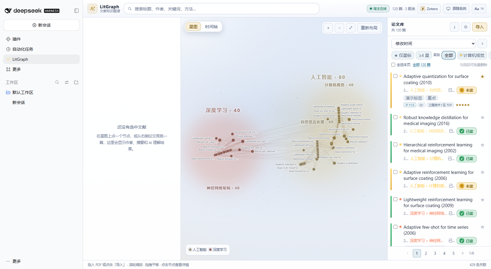
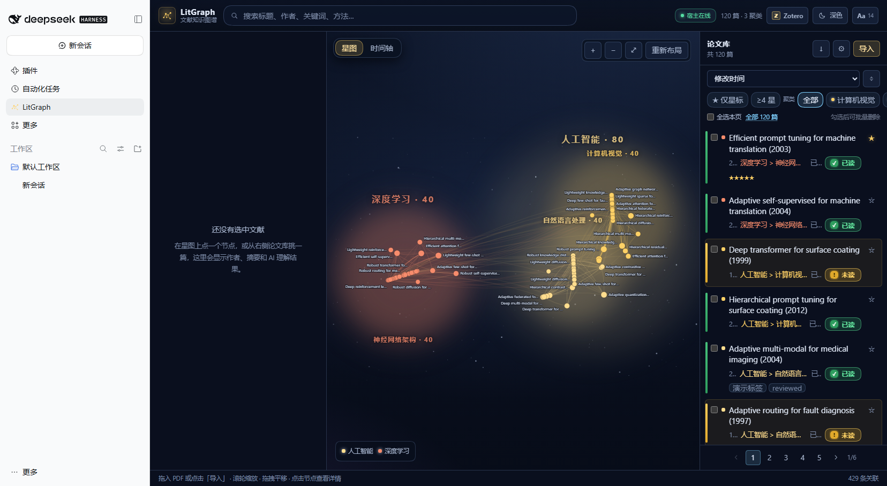
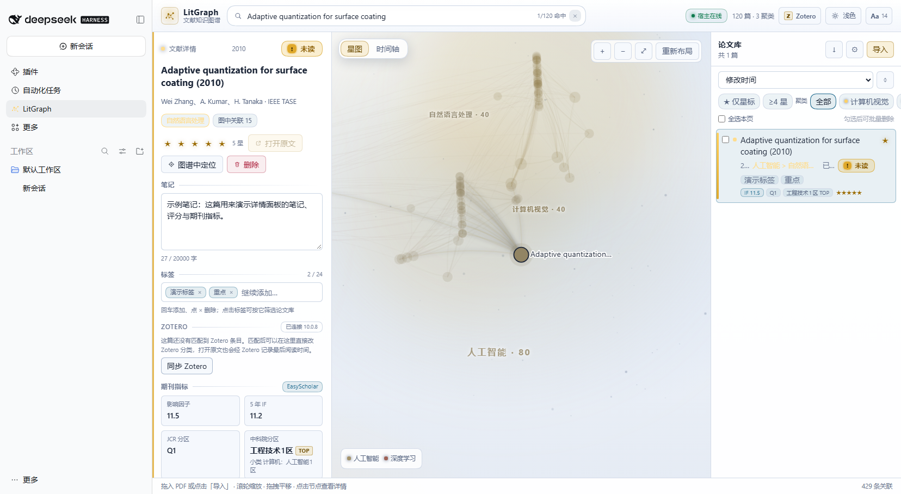
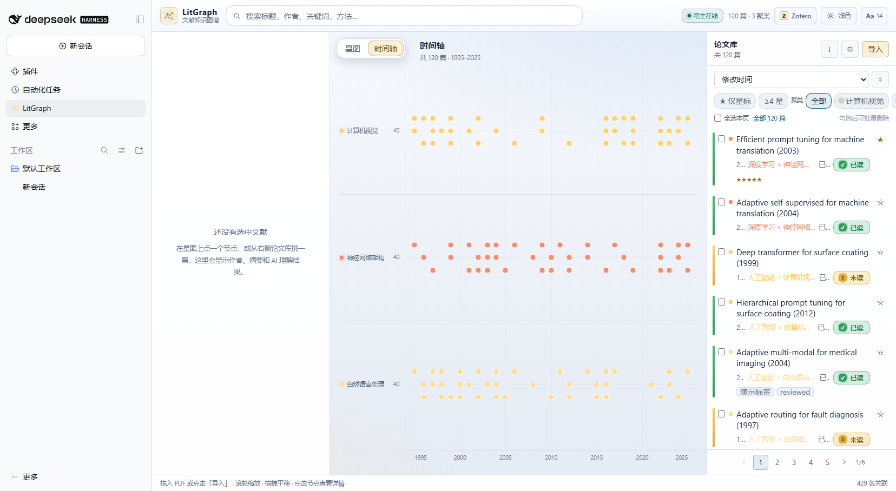

# dsh-litgraph · Literature Knowledge Graph

**English** · [中文](README.zh-CN.md)

A DeepSeek Harness plugin: a literature knowledge-graph workbench. A star-map knowledge graph in the center
(galaxies per discipline, constellations per sub-field), search on top, paper details on the left,
library on the right (sort/paginate/star/tags/cluster filter), plus a timeline view.
Drop a PDF into the panel (or click "Import", or batch-import from Zotero) → extract text (scanned PDFs are
transcribed page by page by the model's vision by default) → let the model understand it
(metadata, Chinese abstract, keywords, taxonomy) → store it and light up the star map.

## Screenshots

Demo data is a synthetic library generated by script (`scripts/seed-scale.mjs`, 120 papers / 6 categories), not real papers.

| Star map · light | Star map · dark |
| --- | --- |
|  |  |

| Details: read state / 5-star rating / journal metrics | Timeline view |
| --- | --- |
|  |  |

## Features

- **Star map**: three-tier "galaxy → constellation → paper" layout. A galaxy is the cloud of papers in one
  top-level discipline (colored nebula + field caption); a constellation is a second-level sub-field (same hue,
  different lightness within a discipline); each paper is a glowing dot, clustered inside its sub-field.
  Wheel zoom, drag to pan, "Re-layout"; search hits breathe with a halo while the rest fade; click a node for details.
  1000 papers measured at 239 ms to render, no long tasks while zooming; the overview draws dots only — titles and
  node labels appear when zoomed in — and galaxy/constellation captions use greedy layout so they never overlap.
- **Cluster granularity**: switch in settings between level 1 (broad discipline) / level 2 (sub-field, default) /
  level 3 (specific topic); the star map re-clusters for the new level.
- **Timeline**: layered by year, papers with unknown year are listed in a separate column at the bottom.
- **Insight** (third tab, "research trends inside this library"): scope = current cluster / same discipline / all
  papers (settings default: current cluster), recent window 3/5/10 years (default 3). It lists the shared research
  objects, a method radar (papers / first year / recent share / trend: new / rising / steady / cooling / average
  rating), how the approach evolved, solved vs. open limits, blank method×problem combinations and research questions
  worth trying. Everything is derived from this library's own papers — one model call per scope, cached on disk under
  `<data root>/insights/`. Every statement carries evidence chips that jump back to the star map; cards can be saved
  into the paper's notes or exported as Markdown. The banner states plainly that this is statistics + inference over
  N local papers, **not** a claim about the research frontier.
- **Details panel**: title/authors/year/venue/categories/edge count/page stats/abstract/AI summary; editable notes
  and tags; 1–5 star rating (rating ≥ 1 implies starred; clicking the same star again clears it); journal metrics card
  (impact factor / 5-year IF / JCR quartile / CAS partition + TOP badge / sub-categories / ESI, from easyScholar,
  with a "Refresh metrics" button); "Open PDF" calls
  `zotero://open-pdf/library/items/<key>` for Zotero-attached papers, handing the PDF back to Zotero and letting
  Zotero's PDF handler open it (RetainPDF locally, i.e. Zotero's import path), and writes back the last-read time;
  non-Zotero papers are imported through RetainPDF directly, falling back to the system default program; plus
  locate-in-graph and delete.
  **Zotero section**: connection status/version, item key, last-read time, last sync (read-only), and the paper's
  Zotero collection chips — "Edit collections" lets you tick collections and saves them back to Zotero; use
  "Re-sync" after changing collections in Zotero; old records without an item key get one via "Sync Zotero"
  (title matching).
- **Library**: sort by modified time/title/year/added time/rating ascending or descending, pagination, cluster filter,
  search integration, starred-only, tag filter, "≥4 stars" filter, inline badges (rating + IF/partition),
  BibTeX export (`litgraph-library.bib`).
  Every row shows a **read / unread** state: a 4 px status bar on the left (green = read, amber = unread with a
  breathing glow), a pale yellow background for unread rows, a solid icon badge at the row end
  (green ✓ read / amber ! unread); the details title row has the same larger badge and the panel has a status-colored
  outline, and hovering the badge shows the last-read time. The state follows Zotero sync data (`lastRead`); opening
  the PDF through Zotero marks it read.
  Rows are selectable: select all on page / select all across pages / batch delete (with confirmation).
- **Import**: drag-and-drop or button upload of PDFs; scanned PDFs are transcribed page by page by the model's vision
  first (first 20 pages), and fall back to free local Windows OCR (first 40 pages) when the model is unavailable or
  reads nothing; settings can force "model vision" or "local OCR".
  The Zotero panel can scan the local library and batch "Import PDFs" or "Import records only" (metadata + abstract,
  no parsing time).
- **Settings**: taxonomy `free` (model grows categories) / `fixed` (built-in discipline tree); graph cluster level
  1/2/3; scanned-PDF OCR `auto` (model first, local fallback) / `model` (model vision only) / `windows`
  (free local OCR only).
- **Theme**: follow system / dark / light, font size 14/15/16; the star map, details and Zotero dialog are all light
  in light mode.

## Layout

- `src/host/` — host half (cordis plugin, ESM): HTTP routes, storage, import pipeline, LLM, graph building, OCR,
  Zotero, journal metrics (`metrics.ts`), library-trend aggregation (`insights.ts`), opening PDFs (`open.ts`).
- `src/client/` — web half (CJS module-federation factory): three-column UI, star-map SVG + force layout, details,
  library, timeline, insight view, Zotero dialog.
- `lib/index.js` (+ `pdfjs-*.js` chunks) and `lib/client.js` — build output (`npm run build`, tsdown).
  **When installing/updating, the pdfjs chunks under `lib/` must be copied together with index.js**.
- Data root: `%USERPROFILE%\.dsh\litgraph` (`papers/` index JSON, `sources/` originals, `tmp/`, `settings`).
- Dependencies: `unpdf` (PDF parsing/rendering), `@napi-rs/canvas` (rasterizing scanned pages), `sql.js`
  (read-only Zotero sqlite).

## Requirements

- Node.js >= 22 (build and host half)
- DeepSeek Harness (desktop app or `dsh web`), plugin attached to a profile
- Optional Windows feature: local OCR (`Windows.Media.Ocr`; with only the `zh-Hans-CN` recognizer installed it still
  reads English but confuses o/0 and l/I)
- Optional: Zotero 7 (import records/PDFs, write back collections, open PDFs), RetainPDF (PDF reader)

## Install

```powershell
git clone <this repo> dsh-litgraph
cd dsh-litgraph
npm ci
npm run build
npm run install:desktop
```

`install:desktop` is idempotent: it ensures the profile patch
(`%USERPROFILE%\.dsh\profiles\<profile>\cordis.patch.yml`) has exactly one `litgraph` insert pointing at this
repo's `lib/index.js`; it also scans local listening ports, identifies the running host by its data root, compares the
sha256 of `lib/index.js` with `hostHash` from `/status`, and tells you whether the host half is current
(`--port` to pin a port). Host-half changes require a full app restart.

Manual install is equivalent to appending the following to the profile patch:

```yaml
- insert:
    - id: litgraph
      name: 'C:/path/to/dsh-litgraph/lib/index.js'
```

The `react` runtime is provided by the host.

## Update loop (important)

- **Client half** (`src/client/**`): `npm run build` → press Ctrl+R in the app window.
- **Host half** (`src/host/**`): `npm run build` → **quit and reopen the app once**.
  dsh's HMR can add patch entries to a running host, but cannot hot-swap the modules behind an already-started entry
  (measured 2026-11-25: changing the insert's name or removing the entry only takes effect after a restart), so host
  logic updates always need a restart. Client-only changes (star map, library, theme) do not need a host restart.

## Cheat sheet

- Wheel to zoom, drag to pan, "Re-layout"; top search makes hit nodes glow and shows N/M hits in the corner; Enter opens
  the first hit.
- Click a node: details on the left; notes/tags and star rating are saved automatically and update the library and
  filters immediately.
- "Open PDF" in details: Zotero-imported papers go through `zotero://open-pdf` (Zotero's built-in reader, allows
  annotations); PDFs you dropped in yourself open in the system default reader.
- "Journal metrics" in details: shows IF / JCR / CAS partition when available; otherwise click "Query metrics" to look
  the venue up on easyScholar.
- Right column: sorting, paging, cluster chips (scroll horizontally when they don't fit; thin scrollbar too),
  starred-only, tag chips, BibTeX, import, Zotero.
- Batch organizing: checkboxes on each row; "Select page" selects the current page only, "All N" selects everything
  under the current filter (across pages); once selected, "N selected / Delete selected / Clear" appears, deletion asks
  for confirmation and refreshes both graph and library.
- Top right: theme (system/dark/light), font size (Aa 14/15/16).

## Configuration (env vars / settings)

| Variable | Purpose | Default |
| --- | --- | --- |
| `LITGRAPH_EASYSCHOLAR_KEY` | easyScholar journal-metrics key (or set `metricsSecretKey` in settings) | empty; metrics UI hidden without a key |
| `LITGRAPH_METRICS_DISABLE=1` | Disable journal-metrics fetching | enabled |
| `LITGRAPH_OCR_DISABLE=1` | Disable local Windows OCR (for tests) | enabled |
| `LITGRAPH_ZOTERO_PATH` | Zotero executable path | `%ProgramFiles%\Zotero\zotero.exe` |
| `LITGRAPH_RETAINPDF_PATH` | RetainPDF executable path | common install locations, in order |
| `LITGRAPH_ZOTERO_DATA_DIR` | Zotero data directory | `%USERPROFILE%\Zotero`, else read from Zotero prefs |

Settings (`GET|PUT /api/litgraph/settings`, UI in the right-column settings dialog): `taxonomyMode`
(`free`/`fixed`), `clusterLevel` (1/2/3), `ocrEngine` (`auto`/`model`/`windows`), `metricsSecretKey`,
`metricsEnabled`, and the insight defaults `insightScope` (`cluster`/`group`/`all`), `insightRecentYears` (1–30),
`insightSaveNotes`, `insightPrecompute`.

## Data and privacy

- All data stays on this machine: `%USERPROFILE%\.dsh\litgraph` (`papers/` index, `sources/` originals,
  `tmp/`, `settings`).
- When importing a PDF, the extracted text is sent to the currently configured model (deepseek-flash by default) for
  metadata/abstract/taxonomy extraction; if the model is unavailable the import fails with a routing hint. There is no
  fully local flow except "Import records only" — categories and abstracts need the model.
- Journal metrics send only the journal name to easyScholar.
- Zotero access reads a temporary copy of `zotero.sqlite`; writing collections/modification dates goes through
  Zotero's local API and requires you to authorize once in the Zotero dialog.
- No telemetry, no remote service, no accounts; the plugin serves on the host's existing local HTTP port
  (`/api/litgraph/*` is unauthenticated, localhost only).

## Tests

```powershell
npm run build
npm run smoke                   # client bundle: 22 checks (render/search/details/paging/drag-upload)
node scripts/test-host.mjs      # host half: 160 checks (real PDFs, mock LLM, dedupe, persistence, Zotero paths, rating/settings/open/metrics)
node scripts/seed-scale.mjs --root <dataRoot> --count 1000 --clusters 12 --seed 7   # synthetic 1000-paper load-test library
```

`test-host.mjs` sets `LITGRAPH_OCR_DISABLE=1` so scanned-PDF cases reliably take the `needs_ocr` branch (no dependency
on the local OCR engine).
Test PDFs are not committed: put three samples at `fixtures/paper.pdf` (text layer), `fixtures/paper-2.pdf`
(text layer), `fixtures/scanned.pdf` (image-only scan), or point `LITGRAPH_TEST_PDF` / `LITGRAPH_TEST_PDF_2` /
`LITGRAPH_TEST_SCAN` elsewhere; when a file is missing the script prints `missing ... PDF` and exits with code 2.
`scripts/zotero-*.mjs` are development probes that need a real local Zotero library and Edge (headless CDP); they are
not CI cases.

## Model routing (credential troubleshooting)

The plugin does not hard-code a provider: each call picks a route in this order — explicit env/config → the host's
default model (the agent default model in settings) → built-in deepseek-official → any other registered provider; when a
route reports a "route unavailable" error such as `MISSING_CREDENTIAL` / `ACCOUNT_SIGN_IN_REQUIRED` /
`UNAUTHORIZED`, it moves to the next one and remembers the working route.

- With desktop account login (profile `agent-default-model` = `deepseek-account` / `deepseek-flash`) the plugin
  follows that route and does not require `DEEPSEEK_API_KEY`.
- If every route is unavailable, the job failure lists the attempted routes
  (`tried deepseek-account/...: ACCOUNT_SIGN_IN_REQUIRED, ...`); sign in or fill in a key under Settings → Models.
- Papers left in "failed" state because of earlier credential problems are not re-run automatically: re-importing the
  same batch (Zotero panel → Import PDFs again) reuses those records and retries, or call
  `POST /api/litgraph/retry-failed` to retry all of them.

## Known limitations

- **OCR**: default `auto` = model vision first (`MAX_VISION_PAGES` 20 pages, one `deepseek-flash` vision call per page;
  a 102-page Chinese scan measured 19 pages in 34 s, 16k characters, with clearly better paragraphs/formulas than local
  OCR, about ¥0.02–0.05 per paper); only when the model is unavailable or reads nothing does it fall back to Windows
  local OCR (`MAX_OCR_PAGES` 40 pages, free, about 8–18 s for 40 pages; this machine has only the `zh-Hans-CN`
  recognizer, Chinese comes out with spaces between characters, English confuses o/0 and l/I). Figures and tables still
  need manual checking.
- **Cost**: one deepseek-flash extraction per text-layer paper, about ¥0.01 and 2–5 s; ~$1–1.6 for 1000 papers.
  Scanned papers add vision OCR (one call per page), about ¥0.02–0.05 per paper for 20 pages.
- **Taxonomy**: `free` mode lets the model grow "level1 > level2 > level3" incrementally, so different batches may
  produce similar but not identical categories; `fixed` mode uses the built-in discipline tree.
- **Graph edges**: adjacent edges within the same second-level sub-field, keyword similarity inside a cluster
  (Jaccard ≥ 0.2, top 2), hub edges between sub-fields of the same discipline, plus model-suggested relations.
  References are not parsed, so there are no citation/co-citation edges.
- **Journal metrics**: easyScholar fast endpoint (max 2 requests/s; the host serializes at 550 ms and caches 30 days in
  memory). Venues such as ICLR/NIPS usually have no partition data and stay empty rather than storing junk; you can put
  your own key in settings or override with `LITGRAPH_EASYSCHOLAR_KEY`. When unset or disabled
  (`LITGRAPH_METRICS_DISABLE=1`) the metrics UI is simply hidden.
- **Open PDF**: needs Zotero installed locally and the paper linked to a Zotero item (with an attachment key); for old
  records without a key the plugin syncs by title once when opened (unmatched ones stay unlinked), and unlinked papers
  fall back to RetainPDF/system default, or report "no file".
- **Zotero write-back**: write requests to Zotero's local API need an API key; the first write (collections/modified
  date) makes Zotero show `LitGraph wants access` — choose "Always Allow". The key is stored in the data root
  `settings` and can be deleted or replaced. Without authorization "Open PDF" still works (Zotero updates the last-read
  time itself) but the modified date and collections are not written back.
- **Zotero import**: when Zotero's local API is not enabled (`/api/users/0/items` 403) the plugin falls back to a
  read-only copy of `zotero.sqlite`; Zotero's WAL means changes from the last few minutes may not be in the copy —
  re-scan before importing.
- **Insight**: aggregates only what is in this library (no citation database behind it), samples at most 60 papers
  per scope for the prompt, and spends one model call per generation (5–20 s, about ¥0.01) cached by scope + prompt
  version; press "Regenerate" after importing new papers. Read "gaps" and "questions" as brainstorming prompts, not
  as facts.
- **Scale**: 1000 papers measured at ~239 ms to get nodes into the DOM, no long tasks while zooming,
  9 sub-fields / 5 galaxies; with tens of thousands of papers the SVG still costs CPU (labels and captions hidden in the
  overview, shown when zoomed; canvas/virtualization not implemented yet).

## Main API (host half, unauthenticated)

- `GET /api/litgraph/status` — paper/cluster counts, data root, `build`, `hostHash`
- `GET /api/litgraph/graph` — nodes/edges/clusters
- `GET /api/litgraph/papers?sort&order&page&pageSize&q&cluster&tag&starred&minRating`
  (`sort` supports `rating`; `minRating` filters 1–5)
- `GET|PATCH|DELETE /api/litgraph/paper?id=` — details; PATCH updates `notes/tags/starred/rating(0–5)`
- `GET|PUT /api/litgraph/settings` — `taxonomyMode: 'free' | 'fixed'`, `clusterLevel: 1 | 2 | 3`,
  `ocrEngine: 'auto' | 'windows' | 'model'`, `metricsSecretKey`, `metricsEnabled`
- `POST /api/litgraph/open` — `{id}` → open the original with the Zotero reader or the system default program
  (404 `no file` when there is no file)
- `POST /api/litgraph/metrics/refresh` — `{ids?}` queue journal-metric fetches (omit ids for all)
- `GET /api/litgraph/metrics/probe?venue=` — query a single journal/conference name, for troubleshooting
- `GET /api/litgraph/insight?scope&cluster&recentYears&refresh` — statistics + one model call for one scope
  (`cluster`/`group`/`all`, optional `refresh=1`); cached under `<data root>/insights/`, 422 when the scope has no
  ready papers
- `POST /api/litgraph/upload` — raw PDF + `x-litgraph-filename`, returns jobId/paperId/duplicate
- `GET /api/litgraph/job?id=` — import progress
- `GET /api/litgraph/file?id=` — original file
- `GET /api/litgraph/ocr/probe` — local Windows OCR capability (model vision uses the host `llm`, no probe needed)
- `POST /api/litgraph/zotero/scan`, `POST /api/litgraph/zotero/import` — scan/import Zotero
- `GET /api/litgraph/zotero/state` — Zotero local API status, collection list, authorization state
- `POST /api/litgraph/zotero/authorize` — obtain Zotero write permission (Zotero shows a dialog; choose Always Allow)
- `POST /api/litgraph/zotero/sync` — match papers to Zotero items by title (fills key/attachment key/collections/last read)
- `PUT /api/litgraph/paper/zotero` — `{id, collections:[key...]}` write collections back to Zotero
- `POST /api/litgraph/retry-failed` — re-run all failed papers (PDF records re-read the original; metadata records re-run
  extraction)

## License

MIT, see [LICENSE](LICENSE).

## Contributing

Issues and PRs welcome. Run `npm run build && npm run smoke` before changing code; for host-side changes
(`src/host/**`) also run `node scripts/test-host.mjs`. Make sure no personal paths, keys or real paper PDFs end up in
the repository.
