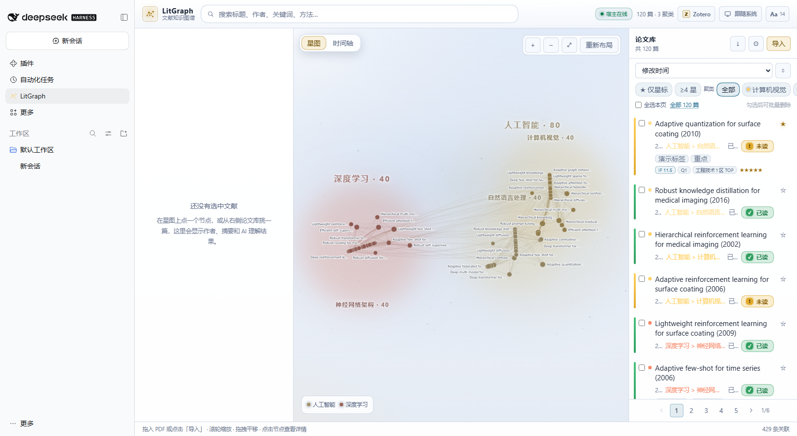
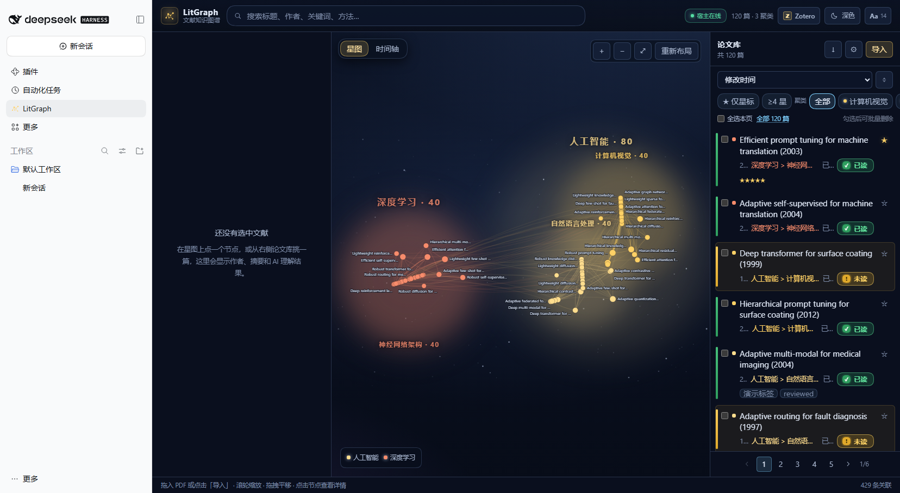
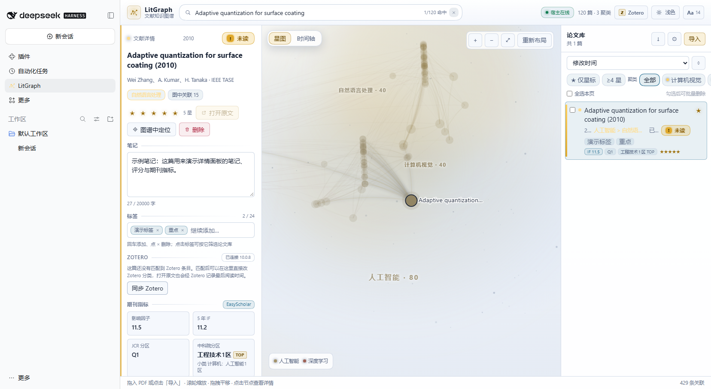
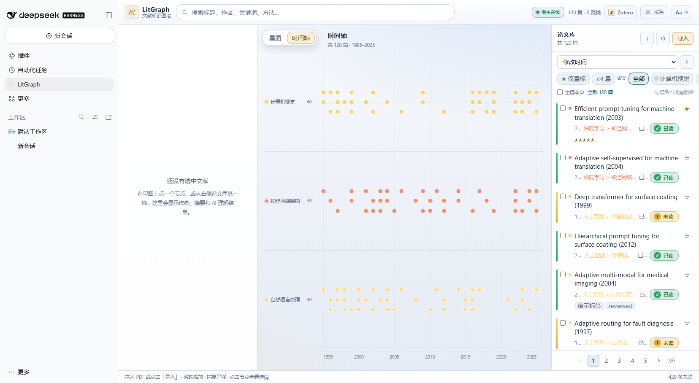

# dsh-litgraph · 文献知识图谱

[English](README.md) · **中文**

DeepSeek Harness 插件：文献知识图谱工作台。中间星空知识图谱（按学科/支线分星座）、顶上搜索、
左栏文献详情、右栏论文库（排序/分页/星标/标签/聚类筛选），另有时间轴视图。
把 PDF 拖进面板（或点「导入」，或从 Zotero 批量导入）→ 解析文本（扫描件默认交给模型视觉逐页转录）→ 让模型理解
（元数据、中文摘要、关键词、分类树）→ 入库并点亮星图。

## 截图

演示数据为脚本生成的合成文献库（`scripts/seed-scale.mjs`，120 篇 / 6 类目），不是真实论文。

| 星图 · 浅色 | 星图 · 深色 |
| --- | --- |
|  |  |

| 详情：已读状态 / 五星评分 / 期刊指标 | 时间轴视图 |
| --- | --- |
|  |  |

## 功能

- **星图**：三层「星系 → 星座 → 论文」布局 —— 星系是按一级学科聚出的云团（彩色星云 + 领域标题），
  星座是二级子领域（同一学科下的子领域用同色系不同明度），每篇论文是一个发光点，距离按子领域内聚。
  滚轮缩放、拖拽平移、「重新布局」；搜索命中节点呼吸光晕、其余淡出；点节点看详情。
  1000 篇实测 239ms 完成渲染、滚轮无长任务；总览只画节点，放大后才出标题与节点标签，
  星系/星座标题用贪心排布避让，不会互相压字。
- **聚类粒度**：设置里可切换 一级（宽学科）/ 二级（子领域，默认）/ 三级（具体主题），星图按新粒度重聚类。
- **时间轴**：按年份分层展示，年份未知的单列在底部。
- **洞察**（第三个视图，回答「库内这类研究都在用什么方法、哪些在变热」）：作用域可选 当前聚类 / 同一学科 /
  全部文献（设置里定默认，默认当前聚类），近期窗口 3/5/10 年（默认 3 年）。展示共同研究对象、方法雷达
  （篇数 / 首次出现年份 / 近期占比 / 趋势：新出现·升温·平稳·退潮 / 平均评分）、方法演进、已解决与局限、
  空白方法×问题组合、值得尝试的研究问题。内容全部由本库论文统计 + 一次模型调用得出，结果缓存在
  `<数据根>/insights/`；每条结论都带证据论文 chips，点击可跳回星图；卡片可存进论文笔记或导出 Markdown。
  页面顶部明写「基于本库 N 篇的统计与推测，不是学界研究前沿」。
- **详情栏**：标题/作者/年份/会议/分类/图中关联数/页面统计/摘要/AI 总结；可编辑笔记、标签；
  1–5 星评分（评分 ≥1 自动算星标，再点同一颗星清零）；期刊指标卡（影响因子 / 5 年 IF / JCR 分区 /
  中科院分区 + TOP 徽标 / 小类 / ESI，来自 easyScholar，可点「重新查询指标」）；
  「打开原文」按 Zotero 附件 key 调 `zotero://open-pdf/library/items/<key>`，把 PDF 交回 Zotero，
  再由 Zotero 的 PDF 处理程序打开（本机是 RetainPDF，即 Zotero 的导入路径），并写回最后阅读时间；
  非 Zotero 来源的文献走 RetainPDF 直接导入，实在没有就用系统默认程序打开原件；另有图谱中定位、删除。
  **Zotero 区块**：显示连接状态/版本、条目 key、最后阅读时间、「最后同步」（只读），
  以及该文献在 Zotero 里的分类 chips —— 点「编辑分类」可勾选集合，保存后直接写回 Zotero；
  Zotero 分类改动后点「重新同步」；老记录没有条目 key 时点「同步 Zotero」按标题匹配补上。
- **论文库**：修改时间/标题/年份/加入时间/评分升降序、分页、聚类筛选、搜索联动、仅星标、按标签筛选、
  「≥4 星」筛选、行内徽标（评分 + IF/分区）、BibTeX 导出（`litgraph-library.bib`）。
  每行带 **已读 / 未读** 状态：左侧 4px 状态条（绿=已读 / 琥珀=未读且呼吸发光）、未读行淡黄底色、
  行尾实心图标徽标（绿底 ✓已读 / 琥珀底 !未读）；详情页标题行右侧同款加大徽标，面板左侧还有状态色描边，
  悬浮徽标显示最后阅读时间。状态完全跟随 Zotero 同步数据（`lastRead`），点「打开原文」经 Zotero 打开后即变已读。
  每行可勾选，支持全选本页 / 跨页全选 / 批量删除（删除前确认）。
- **导入**：拖拽/按钮上传 PDF；扫描版 PDF 默认先用模型视觉逐页转录（前 20 页），模型不可用或没读出文字时
  自动退回免费 Windows 本地 OCR（前 40 页）；设置里可强制「模型视觉」或「本地 OCR」。
  Zotero 面板可扫描本地库并批量「导入 PDF」或「仅导入记录」（题录 + 摘要，不花解析时间）。
- **设置**：分类体系可切换 `free`（模型自由生长）/ `fixed`（固定学科目录）；图谱聚类粒度 1/2/3 档；
  扫描件 OCR 可选 `auto`（模型优先、失败回退本地）/ `model`（只用模型视觉）/ `windows`（只用免费本地 OCR）。
- **主题**：跟随系统 / 深色 / 浅色，字号 14/15/16 三档；浅色下星图、详情、Zotero 弹窗都是浅色。

## 结构

- `src/host/` —— 宿主半区（cordis 插件，ESM）：HTTP 路由、存储、导入管线、LLM、建图、OCR、Zotero、
  期刊指标（`metrics.ts`）、库内趋势聚合（`insights.ts`）、打开原文（`open.ts`）。
- `src/client/` —— Web 半区（CJS 模块联邦工厂）：三栏 UI、星图 SVG + 力导向布局、详情、列表、时间轴、洞察视图、
  Zotero 弹窗。
- `lib/index.js`（+ `pdfjs-*.js` 分块）与 `lib/client.js` —— 构建产物（`npm run build`，tsdown）。
  **安装/更新时 `lib/` 下的 pdfjs 分块必须和 index.js 一起拷走**。
- 数据根：`%USERPROFILE%\.dsh\litgraph`（`papers/` 索引 JSON、`sources/` 原件、`tmp/`、`settings`）。
- 依赖：`unpdf`（PDF 解析/渲染）、`@napi-rs/canvas`（扫描页栅格化）、`sql.js`（只读 Zotero sqlite）。

## 环境要求

- Node.js >= 22（构建与宿主半区运行）
- DeepSeek Harness（桌面端或 `dsh web`），插件挂在某个 profile 上
- Windows 可选能力：本地 OCR（`Windows.Media.Ocr`，只带 `zh-Hans-CN` 识别器时英文也能读但 o/0、l/I 易混）
- 可选：Zotero 7（导入题录/PDF、写回分类、打开原文）、RetainPDF（PDF 阅读器）

## 安装

```powershell
git clone <本仓库> dsh-litgraph
cd dsh-litgraph
npm ci
npm run build
npm run install:desktop
```

`install:desktop` 幂等：在 profile patch（`%USERPROFILE%\.dsh\profiles\<profile>\cordis.patch.yml`）里确保只有一条
`litgraph` insert 指向本仓库的 `lib/index.js`；并扫描本地监听端口按数据根认出正在运行的宿主，
对比 `lib/index.js` 的 sha256 与宿主 `/status` 的 `hostHash`，告诉你宿主半区是否已最新（`--port` 可指定端口）。
宿主半区改动必须完全退出并重开应用一次才生效。

手动安装等价于在 profile patch 末尾追加：

```yaml
- insert:
    - id: litgraph
      name: 'C:/path/to/dsh-litgraph/lib/index.js'
```

依赖：`unpdf`（PDF 解析/渲染）、`@napi-rs/canvas`（扫描页栅格化）、`sql.js`（只读 Zotero sqlite）、`react` 运行时由宿主提供。
## 更新循环（重要）

- **前端半区**（`src/client/**`）：`npm run build` → 应用窗口 Ctrl+R 生效。
- **宿主半区**（`src/host/**`）：`npm run build` → **完全退出并重开应用一次**。
  dsh 的 HMR 能在运行中的宿主里新增 patch entry，但不能热替换已启动 entry 背后的模块
  （2026-11-25 实测：改 insert 的 name / 删除 entry 都要重启才生效），所以宿主逻辑更新必须重启。
  仅前端改动（星图/列表/主题等）不需要重启宿主，Ctrl+R 即可。

## 交互速查

- 滚轮缩放、拖拽平移、「重新布局」；顶部搜索命中节点呼吸光晕 + 右上 N/M 命中，回车打开第一条。
- 点击节点：左栏详情；详情里可改笔记/标签、点星星评分（自动保存，列表与筛选即时更新）。
- 详情「打开原文」：Zotero 导入的文献走 `zotero://open-pdf`（Zotero 内置阅读器，可做批注）；
  自己拖进来的 PDF 用系统默认阅读器打开。
- 详情「期刊指标」：有指标直接显示 IF / JCR / 中科院分区；没有就点「查询指标」按会议/期刊名查 easyScholar。
- 右栏：排序、翻页、聚类 chip（一行放不下时可直接用滚轮横向滚动，也有细滚动条）、仅星标、标签 chip、BibTeX、导入、Zotero。
- 批量整理：每行左侧勾选框；顶部「全选本页」只选当前页，「全部 N 篇」按当前筛选全选（跨页），
  选中后出现「已选 N 篇 / 删除所选 / 取消」，删除前有确认框，删完自动刷新星图与列表。
- 顶部右侧：主题（跟随系统/深/浅）、字号（Aa 14/15/16）。

## 配置（环境变量 / 设置项）

| 变量 | 作用 | 默认 |
| --- | --- | --- |
| `LITGRAPH_EASYSCHOLAR_KEY` | easyScholar 期刊指标密钥（也可在设置里填 `metricsSecretKey`） | 空；没有密钥时指标功能自动隐藏 |
| `LITGRAPH_METRICS_DISABLE=1` | 关闭期刊指标抓取 | 开启 |
| `LITGRAPH_OCR_DISABLE=1` | 关闭本地 Windows OCR（测试用） | 开启 |
| `LITGRAPH_ZOTERO_PATH` | Zotero 可执行文件路径 | `%ProgramFiles%\Zotero\zotero.exe` |
| `LITGRAPH_RETAINPDF_PATH` | RetainPDF 可执行文件路径 | 依次尝试常见安装位置 |
| `LITGRAPH_ZOTERO_DATA_DIR` | Zotero 数据目录 | `%USERPROFILE%\Zotero`，识别失败时读 Zotero prefs |

设置项（`GET|PUT /api/litgraph/settings`，UI 在右栏设置弹窗）：`taxonomyMode`（`free`/`fixed`）、
`clusterLevel`（1/2/3）、`ocrEngine`（`auto`/`model`/`windows`）、`metricsSecretKey`、`metricsEnabled`，
以及洞察默认值 `insightScope`（`cluster`/`group`/`all`）、`insightRecentYears`（1–30）、`insightSaveNotes`、
`insightPrecompute`。

## 数据与隐私

- 所有数据只存本机：`%USERPROFILE%\.dsh\litgraph`（`papers/` 索引、`sources/` 原件、`tmp/`、`settings`）。
- 导入一篇 PDF 时，解析出的文本会发给当前配置的模型（默认 deepseek-flash）做元数据/摘要/分类抽取；
  模型不可用时导入失败并给出路由提示。不需要联网能力时可只用「仅导入记录」以外的本地流程不可行 —— 分类与摘要依赖模型。
- 期刊指标只把期刊名发给 easyScholar。
- Zotero 访问只读 `zotero.sqlite` 的临时副本；写回分类/修改日期走 Zotero 本地 API，需要你在 Zotero 弹窗里授权一次。
- 没有遥测、没有远程服务、没有账号体系；插件监听的是宿主已有的本地 HTTP 端口（`/api/litgraph/*` 免鉴权，仅本机）。
## 测试

```powershell
npm run build
npm run smoke                   # 前端 bundle：22 项（渲染/搜索/详情/分页/拖拽上传）
node scripts/test-host.mjs      # 宿主半区：160 项（真实 PDF、模拟 LLM、去重、持久化、Zotero 路径、评分/设置/打开原文/指标）
node scripts/seed-scale.mjs --root <dataRoot> --count 1000 --clusters 12 --seed 7   # 合成千篇压测库
```

`test-host.mjs` 会设 `LITGRAPH_OCR_DISABLE=1`，让扫描件用例稳定走 `needs_ocr` 分支（不依赖本机 OCR 引擎）。
测试用 PDF 不入库：把三份样本放到 `fixtures/paper.pdf`（带文本层）、`fixtures/paper-2.pdf`（带文本层）、
`fixtures/scanned.pdf`（纯图片扫描件），或用 `LITGRAPH_TEST_PDF` / `LITGRAPH_TEST_PDF_2` / `LITGRAPH_TEST_SCAN` 指到别处；
缺文件时脚本打印 `missing ... PDF` 并以 exit code 2 退出。
`scripts/zotero-*.mjs` 是开发期探针，依赖本机真实 Zotero 库与 Edge（headless CDP），不作为 CI 用例。

## 模型路由（凭据问题排查）

插件不写死 provider：每次调用按「环境变量/配置显式指定 → 宿主默认模型（设置里的 agent default model）
→ 内置 deepseek-official → 其它已注册 provider」的顺序选路由；某条路由报
`MISSING_CREDENTIAL` / `ACCOUNT_SIGN_IN_REQUIRED` / `UNAUTHORIZED` 这类「路由不可用」错误时，
自动换下一条并记住成功的那条。

- 桌面端用账号登录（profile 里 `agent-default-model` = `deepseek-account` / `deepseek-flash`）时，
  插件会直接跟随这个路由，不再要求 `DEEPSEEK_API_KEY`。
- 如果所有路由都不可用，job 的失败信息会列出尝试过的路由（`tried deepseek-account/...: ACCOUNT_SIGN_IN_REQUIRED, ...`），
  照提示在「设置 → 模型」里登录/填 key 即可。
- 之前因凭据失败、状态为“失败”的文献不会自动重跑：重新导入同一批（Zotero 面板再点一次导入 PDF）
  会复用这些记录并重试；也可以直接调 `POST /api/litgraph/retry-failed` 一次性重跑。

## 已知限制

- **OCR**：默认 `auto` = 模型视觉优先（`MAX_VISION_PAGES` 20 页，每页一次 `deepseek-flash` 视觉调用，
  102 页中文扫描件实测 19 页 34 秒、1.6 万字符，段落/公式明显好于本地 OCR，约 ¥0.02–0.05/篇）；
  模型不可用或读不出字才回退 Windows 本地 OCR（`MAX_OCR_PAGES` 40 页、免费、40 页约 8–18 秒；
  本机只有 `zh-Hans-CN` 识别器，中文带字间空格，英文 o/0、l/I 易混）。图表内容仍不理想要人工核对。
- **成本**：每篇文本层论文抽取一次 deepseek-flash，约 ¥0.01、2–5 秒；1000 篇约 $1–1.6。
  扫描件另加视觉 OCR（每页一次调用），按 20 页算约 ¥0.02–0.05/篇。
- **分类**：`free` 模式由模型增量生成「一级 > 二级 > 三级」，不同批次可能长出相近但不完全相同的类目；
  `fixed` 模式走内置学科目录。
- **图谱边**：同一二级子领域内相邻连边、簇内关键词相似（Jaccard ≥ 0.2，top 2）、同一学科下各子领域代表篇
  连成枢纽、模型给出的关联提示；不解析参考文献，所以没有引用/共被引关系。
- **期刊指标**：easyScholar 快速接口（1 秒最多 2 次请求，宿主内部已串行限速 550ms + 30 天内存缓存）。
  会议（如 ICLR/NIPS）通常查不到分区，会保持空值且不写垃圾数据；密钥可在设置里改成自己的，
  也可用 `LITGRAPH_EASYSCHOLAR_KEY` 覆盖。未配置/被禁（`LITGRAPH_METRICS_DISABLE=1`）时只隐藏指标。
- **打开原文**：需要本机装有 Zotero 且文献已链接到 Zotero 条目（带附件 key）；老记录没有 key 时
  打开插件会自动按标题同步一次（匹配不上的保持未链接），没链接的退化为 RetainPDF/系统默认程序打开原件，
  原件也没有则提示 no file。
- **Zotero 写回**：Zotero 本地 API 的写请求需要 API key，第一次写（改分类/记修改日期）时 Zotero 会弹
  `LitGraph wants access`，请选「Always Allow / 始终允许」，key 存在数据根 `settings` 里，可删可换。
  未授权时打开原文仍可用（Zotero 自己会更新「最后阅读时间」），但「修改日期」和分类不会写回。
- **Zotero**：**Zotero 导入**：Zotero 的本地 API 未启用（`/api/users/0/items` 403）时回退为只读 `zotero.sqlite`
  副本；Zotero 的 WAL 意味着最近几分钟的改动可能不在副本里，导入前请重新扫描。
- **洞察**：只统计本库已有论文（背后没有引文数据库），每次生成最多取 60 篇做样本、一次模型调用（5–20 秒，
  约 ¥0.01），按「作用域 + 提示词版本」缓存；导入新论文后点「重新生成」才更新。「空白组合 / 研究问题」是
  头脑风暴式的推测，不是事实结论。
- **规模**：1000 篇实测节点进 DOM 约 239ms、滚轮无长任务、9 子领域 / 5 星系；上万篇时 SVG 仍会吃 CPU
  （总览隐藏标签与标题、放大才显示，已按这个思路优化，暂未做 canvas/虚拟化）。

## 主要接口（宿主半区，免鉴权）

- `GET /api/litgraph/status` —— 论文/聚类计数、数据根、`build`、`hostHash`
- `GET /api/litgraph/graph` —— 节点/边/聚类
- `GET /api/litgraph/papers?sort&order&page&pageSize&q&cluster&tag&starred&minRating`
  （`sort` 支持 `rating`；`minRating` 1–5 过滤）
- `GET|PATCH|DELETE /api/litgraph/paper?id=` —— 详情；PATCH 改 `notes/tags/starred/rating(0–5)`
- `GET|PUT /api/litgraph/settings` —— `taxonomyMode: 'free' | 'fixed'`、`clusterLevel: 1 | 2 | 3`、
  `ocrEngine: 'auto' | 'windows' | 'model'`、`metricsSecretKey`、`metricsEnabled`，以及洞察默认值
  `insightScope` / `insightRecentYears` / `insightSaveNotes` / `insightPrecompute`
- `POST /api/litgraph/open` —— `{id}` → 用 Zotero 阅读器或系统默认程序打开原件（无文件返回 404 `no file`）
- `POST /api/litgraph/metrics/refresh` —— `{ids?}` 排队抓期刊指标（省略 ids 则全部）
- `GET /api/litgraph/metrics/probe?venue=` —— 直接查一个期刊/会议名，便于排查
- `GET /api/litgraph/insight?scope&cluster&recentYears&refresh` —— 单个作用域的统计 + 一次模型调用
  （`scope` 为 `cluster`/`group`/`all`，可选 `refresh=1`）；结果缓存在 `<数据根>/insights/`，作用域内没有
  ready 论文时返回 422
- `POST /api/litgraph/upload` —— raw PDF + `x-litgraph-filename`，返回 jobId/paperId/duplicate
- `GET /api/litgraph/job?id=` —— 导入进度
- `GET /api/litgraph/file?id=` —— 原件
- `GET /api/litgraph/ocr/probe` —— 本机 Windows OCR 能力（模型视觉走宿主 `llm`，不需要探测）
- `POST /api/litgraph/zotero/scan`、`POST /api/litgraph/zotero/import` —— 扫描/导入 Zotero
- `GET /api/litgraph/zotero/state` —— Zotero 本地 API 状态、分类列表、是否已授权
- `POST /api/litgraph/zotero/authorize` —— 取 Zotero 写权限（Zotero 会弹窗，选 Always Allow）
- `POST /api/litgraph/zotero/sync` —— 按标题把文献匹配到 Zotero 条目（补 key/附件 key/分类/最后阅读）
- `PUT /api/litgraph/paper/zotero` —— `{id, collections:[key...]}` 把分类写回 Zotero
- `POST /api/litgraph/retry-failed` —— 重跑所有状态为 failed 的文献（PDF 记录读原件、题录记录重跑元数据抽取）

## 许可证

MIT，见 [LICENSE](LICENSE)。

## 贡献

欢迎 issue / PR。改代码前先跑 `npm run build && npm run smoke`；改宿主侧（`src/host/**`）再跑 `node scripts/test-host.mjs`。
提交前请确认没有把个人路径、密钥、真实文献 PDF 带进仓库。
